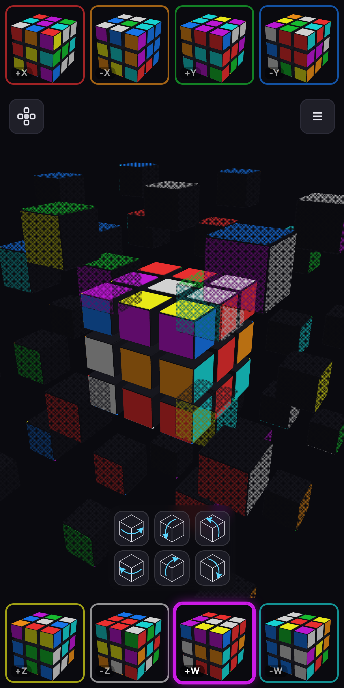

<p align="center">
  
</p>

# Tesserocta

A 4D puzzle in eight views.

**▶ [Play it live](https://vvasin.github.io/tesserocta/)** — runs in any modern browser, phone-first.

<p align="center">
  <a href="https://vvasin.github.io/tesserocta/"></a>
</p>

A 3×3×3×3 twisty puzzle shown as a main tesseract projection plus its eight cubic cells.
Vanilla JS + WebGL 1.0, no build step, no runtime dependencies.

## Setup (fresh machine)

```bash
npm install
npx playwright install chromium    # browser used by the tests
```

## Run

```bash
npm start                          # serves at http://localhost:8791
```

Then open http://localhost:8791/. The page loads `src/*.js` as ES modules directly — there
is **no bundler or build step**.

## Test & lint

```bash
npm test                           # Playwright end-to-end (auto-starts the dev server)
npm run lint                       # ESLint
```

Tests live in `tests/`; they drive the real app and assert it renders and survives every
interaction without console errors. Reference screenshots are written to
`test-results/screenshots/` (gitignored) for manual inspection.

## Layout

```
index.html, style.css     entry point + styles
src/                       app source (ES modules)
assets/                    logo, favicon, README screenshot, link-preview image
scripts/serve.js           zero-dependency static dev server
scripts/make-logo.js       regenerates assets/logo.svg + favicon.svg
tests/                     Playwright specs
playwright.config.js       test runner config (boots the dev server)
eslint.config.js           lint config
CLAUDE.md                  architecture & design rationale — read this before changing rendering
```

See [CLAUDE.md](CLAUDE.md) for the projection model and the reasoning behind the
non-obvious rendering decisions.
